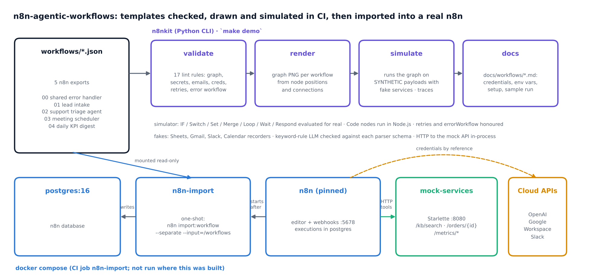
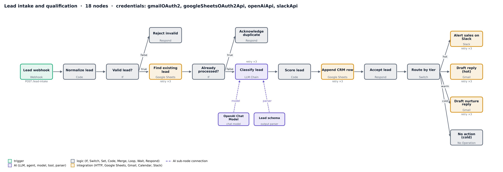
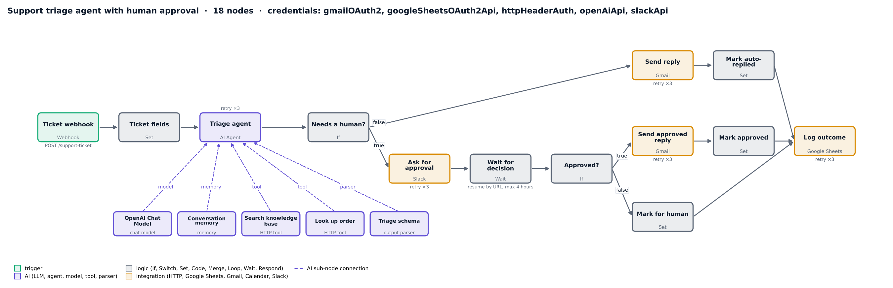
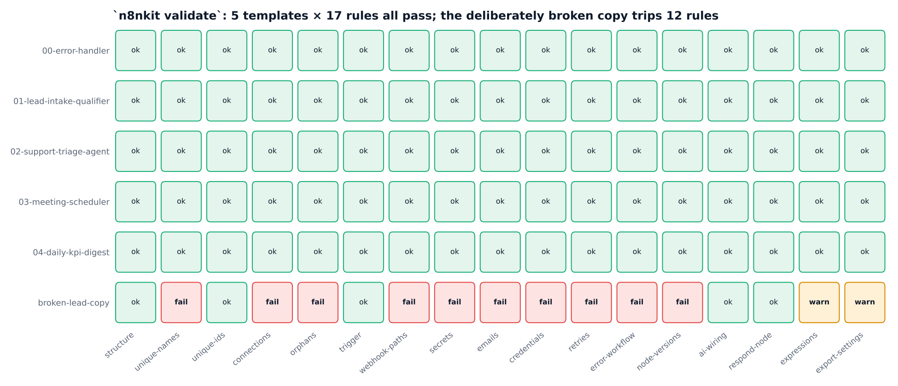
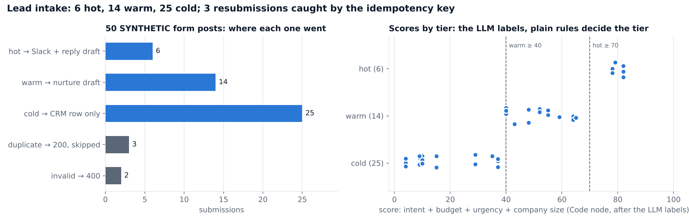
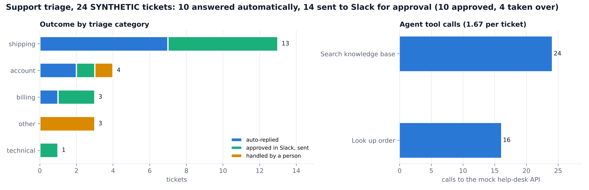

# n8n Agentic Workflows

[](https://github.com/vishavjit-singh/n8n-agentic-workflows/actions/workflows/ci.yml)


Five importable **n8n workflow templates** for common LLM automations, plus **`n8nkit`**, a small Python tool that keeps them honest before they reach an n8n instance:

- **Templates** (`workflows/*.json`, the real n8n export format): an inbound **lead qualifier** (LLM with a structured-output schema, then plain scoring rules), a **support triage agent** with HTTP tools, memory and a **human-approval step** in Slack, a **meeting scheduler** on Google Calendar availability, a **daily KPI digest**, and a **shared error handler** that the others point to through `settings.errorWorkflow`
- **`n8nkit validate`**: 17 lint rules: graph integrity, unique webhook paths, no secrets or real email addresses in parameters, credentials by reference only, retries on every external call, a valid error workflow
- **`n8nkit render`**: draws every workflow from its JSON (the graphs below)
- **`n8nkit simulate`**: runs a workflow's graph locally on sample payloads, with IF, Switch, Set, Merge, Loop and Respond evaluated for real, Code nodes run in Node.js, and fake Google/Slack/LLM services
- **`n8nkit docs`**: writes [`docs/workflows/*.md`](docs/workflows/) (trigger, nodes, credentials, env vars, a sample run)
- **docker compose**: a pinned n8n with Postgres, a one-shot `n8n import:workflow` service, and a mock help-desk/metrics API for the agent's tools

The scenarios are fictional and every payload in the demo is **synthetic**. I built agentic n8n automations in an earlier role. These templates are generic patterns written from scratch for this repo; none of them is a client workflow.



## Why this project

| Problem with LLM automations in n8n | How these templates handle it |
|---|---|
| Free-text LLM answers break the IF and Switch nodes downstream | Every LLM node has a **Structured Output Parser** with a JSON schema (enums for intent, tier inputs, priority). The simulator checks every fake answer against that schema |
| The model decides things it should not | The LLM only labels. Scores, tiers, time slots and anomaly flags are computed in **Code nodes** with plain rules you can read and test |
| A resubmitted form creates a second CRM row and a second alert | The lead workflow derives an **idempotency key** (FNV-1a hash of email + message) and looks it up before calling the LLM. Resubmissions get `200 duplicate` |
| One flaky API call loses the whole execution | `retryOnFail`, `maxTries: 3`, `waitBetweenTries: 2000` on every HTTP, Google, Slack and LLM node (the linter enforces it) |
| Failures go unnoticed | All four workflows set `settings.errorWorkflow` to the **shared error handler**, which posts to Slack and logs to a sheet |
| An agent emails customers something wrong | The support agent auto-sends only confident answers with no refund, legal or security flags. Everything else goes to Slack with approve/reject links, and the workflow **waits** (Wait node, resume by URL, 4-hour limit). Lead replies are only ever saved as **Gmail drafts** |
| Exported JSON leaks keys or personal addresses | The linter scans every parameter for key and token patterns, literal `Authorization`/`X-API-Key` values and non-reserved email addresses. Credentials are references by name with a `null` id |
| "It imported fine on my machine" | CI imports every file into a real n8n with the CLI, exports them back and compares IDs, node counts and error-workflow links |

## The workflows

| File | Trigger | What it does | Credentials |
|---|---|---|---|
| [`00-error-handler`](docs/workflows/00-error-handler.md) | Error Trigger | Formats the failed execution, posts to `#automation-alerts`, appends to an `Errors` sheet | Slack, Google Sheets |
| [`01-lead-intake-qualifier`](docs/workflows/01-lead-intake-qualifier.md) | `POST /webhook/lead-intake` | Normalise → validate (400) → idempotency lookup (200 duplicate) → LLM labels → score → CRM row → 202 → hot: Slack + reply draft, warm: nurture draft, cold: nothing more | OpenAI, Sheets, Gmail, Slack |
| [`02-support-triage-agent`](docs/workflows/02-support-triage-agent.md) | `POST /webhook/support-ticket` (202 at once) | Tools agent with KB search + order lookup (HTTP tools), window memory per customer, structured triage; auto-reply or Slack approval with a Wait; outcome logged | OpenAI, Header Auth, Gmail, Slack, Sheets |
| [`03-meeting-scheduler`](docs/workflows/03-meeting-scheduler.md) | `POST /webhook/schedule-meeting` | LLM turns the request into a duration and window, Calendar returns busy slots, a Code node finds the first free working-hours slot; book + confirm (201), offer 3 alternatives (200) or ask for a day (422) | OpenAI, Google Calendar, Gmail |
| [`04-daily-kpi-digest`](docs/workflows/04-daily-kpi-digest.md) | Cron `0 8 * * 1-5` | Two HTTP calls in parallel → Merge → per-team KPIs and anomaly rules → Loop Over Items emails each team lead → one Slack summary | Header Auth, Gmail, Slack |





The other three graphs are in their docs: [meeting scheduler](docs/workflows/03-meeting-scheduler.md), [KPI digest](docs/workflows/04-daily-kpi-digest.md), [error handler](docs/workflows/00-error-handler.md).

## Results from the demo run

`make demo` lints the exports, draws the graphs, pushes **synthetic** payloads through each workflow in the simulator and writes the charts and docs. Everything below comes from that run. The LLM in the simulator is a deterministic keyword-rule stand-in (see Limitations), so these numbers show that the routing, schemas, tools and error paths are wired correctly. They do not measure how well a real model classifies.

**Lint.** The 5 shipped templates pass all 17 rules. A copy of the lead workflow, broken on purpose in code (a fake key in a header, a real-looking email, a dangling connection, no retries, no error workflow and so on), produces 14 findings across 12 rules:



**Lead intake, 50 synthetic form posts.** 45 were new and valid, 3 were resubmissions of earlier leads with the email in upper case, and 2 had no email or an empty message. The 45 new leads produced 45 CRM rows and 45 LLM calls. The resubmissions never reached the LLM. Nothing was emailed: hot and warm leads got 20 Gmail **drafts**, and the 6 hot ones also got a Slack alert.



**Support triage, 24 synthetic tickets.** The agent made 24 knowledge-base searches and 16 order lookups against the mock API (1.67 tool calls per ticket). 10 tickets were answered automatically and 14 went to Slack for approval. The demo reviewer approved 10 and took over 4 (urgent ones, and drafts without a cited article). The 6 repeat contacts were recognised through the conversation memory.



| Scenario (synthetic) | Result |
|---|---|
| Lead intake, 50 posts | 6 hot · 14 warm · 25 cold · 3 duplicate (200) · 2 rejected (400); 45 CRM rows, 6 Slack alerts, 20 Gmail drafts, 0 emails sent |
| Support triage, 24 tickets | 10 auto-replied · 10 approved in Slack and sent · 4 handled by a person; 24 KB searches, 16 order lookups, 0 errors |
| Meeting scheduler, 12 requests on a calendar with 17 busy slots | 7 booked (201) · 3 alternatives offered (200, a fully blocked Wednesday afternoon) · 2 asked for a day (422) |
| KPI digest, 5 weekday runs | 20 team-lead emails through Loop Over Items, 5 Slack summaries; teams flagged per day: 2, 3, 1, 4, 3 |
| Failure drill: CRM sheet fails 2 times | succeeds on attempt 3 (retry policy), caller gets 202 |
| Failure drill: CRM sheet keeps failing | execution fails after 3 attempts, caller gets 500, the shared error handler runs and posts to `#automation-alerts` |

A run trace for one escalated ticket (from `make demo`):

```
execution 1003 · Support triage agent with human approval · success
  1  Ticket webhook           Webhook                in 1   out 1
  2  Ticket fields            Edit Fields (Set)      in 1   out 1
  3  Triage agent             AI Agent               in 1   out 1           ticket_triage; tools: Search knowledge base, Look up order; memory: 0 earlier
  4  Needs a human?           If                     in 1   out 1/0
  5  Ask for approval         Slack                  in 1   out 1           posted to #support-escalations
  6  Wait for decision        Wait                   in 1   out 1           resumed: decision=approve
  7  Approved?                If                     in 1   out 1/0
  8  Send approved reply      Gmail                  in 1   out 1           sent to customer03@shop.example
  9  Mark approved            Edit Fields (Set)      in 1   out 1
 10  Log outcome              Google Sheets          in 1   out 1           append Triage log
     response 202: {"message": "Workflow was started"}
```

> All payloads, the knowledge base, orders, metrics and calendar are **synthetic** ([`samples.py`](src/n8nkit/samples.py), [`mocks.py`](src/n8nkit/mocks.py), seeded). The full run data is in `reports/simulation.json` and `reports/traces/*.jsonl` after `make demo`.

## Quickstart

```bash
git clone https://github.com/vishavjit-singh/n8n-agentic-workflows.git
cd n8n-agentic-workflows
python -m venv .venv && source .venv/bin/activate
make install
make demo        # validate → render → simulate → charts → docs (needs Node.js for Code nodes)
make test        # 41 tests
```

### Import into n8n

**In the editor:** Workflows → **Import from File** → pick a file from `workflows/`. Import `00-error-handler.json` as well, because the others reference it by ID (`ErrHandlerShared`).

**With the CLI** (any n8n 1.x install):

```bash
n8n import:workflow --separate --input=./workflows
```

**With docker compose** (n8n `1.80.0` pinned in `.env.example`, Postgres 16, the mock API):

```bash
cp .env.example .env      # set N8N_ENCRYPTION_KEY and POSTGRES_PASSWORD
make docker               # docker compose up -d --build; the n8n-import service runs first
open http://localhost:5678
```

The import keeps each workflow's ID, so running it again updates the same five workflows instead of adding copies. Workflows are imported **inactive**.

### Credentials and settings

Credentials are referenced by name with a `null` id. Create them with these names (or pick your own in each node after import):

| Credential name in the templates | n8n type | Used by |
|---|---|---|
| OpenAI account | `openAiApi` | 01, 02, 03 |
| Google Sheets account | `googleSheetsOAuth2Api` | 00, 01, 02 |
| Gmail account | `gmailOAuth2` | 01, 02, 03, 04 |
| Google Calendar account | `googleCalendarOAuth2Api` | 03 |
| Slack account | `slackApi` | 00, 01, 02, 04 |
| Helpdesk API key / Metrics API key | `httpHeaderAuth` (`X-API-Key`) | 02, 04 (any value works for the mock API unless `MOCK_API_KEY` is set) |

Sheet IDs, the calendar ID and the API base URLs are read with `$env` (listed in [`.env.example`](.env.example) and in each workflow's doc). The compose file sets `N8N_BLOCK_ENV_ACCESS_IN_NODE=false` so that works; on an instance that blocks env access, replace those expressions with values.

## Usage

```bash
$ python -m n8nkit validate
5 workflows, 17 rules: 0 errors, 0 warnings

$ python -m n8nkit simulate 01-lead-intake-qualifier --payload examples/lead.json
execution 1001 · Lead intake and qualification · success
  1  Lead webhook             Webhook                in 1   out 1
  2  Normalize lead           Code                   in 1   out 1
  3  Valid lead?              If                     in 1   out 1/0
  4  Find existing lead       Google Sheets          in 1   out 1           read Leads
  5  Already processed?       If                     in 1   out 0/1
  6  Classify lead            Basic LLM Chain        in 1   out 1           lead_classification
  7  Score lead               Code                   in 1   out 1
  8  Append CRM row           Google Sheets          in 1   out 1           append Leads
  9  Accept lead              Respond to Webhook     in 1   out 1           responded 202
 10  Route by tier            Switch                 in 1   out 1/0/0
 11  Alert sales on Slack     Slack                  in 1   out 1           posted to #sales-hot-leads
 12  Draft reply (hot)        Gmail                  in 1   out 1           draft to asha.rao@northwind.example
     response 202: {"status": "accepted", "lead_id": "lead_21b878fd", "tier": "hot"}

$ python -m n8nkit simulate 04-daily-kpi-digest --at 2026-11-17T08:00:00Z   # schedule trigger
$ python -m n8nkit simulate 02-support-triage-agent --payload examples/ticket.json --json   # full record
$ python -m n8nkit render     # docs/images/workflows/*.png
$ python -m n8nkit docs       # docs/workflows/*.md
$ make serve                  # mock API on :8080 (GET /kb/search?q=refund, /orders/ORD-10004, /metrics/orders?date=…)
```

Run `make validate` (strict mode) before committing a re-exported workflow. Exported workflows often pick up `pinData` with real payloads or a credential pasted into a header, and the linter flags both.

## Project structure

```
├── workflows/                    # the five n8n exports (source of truth; edit in n8n and re-export)
├── src/n8nkit/
│   ├── model.py · catalog.py     # workflow graph + known node types, versions, outputs, credentials
│   ├── lint.py · examples.py     # the 17 rules; the deliberately broken copy
│   ├── expressions.py            # evaluator for the n8n expression subset ({{ $json… }}, $('Node'), $now…)
│   ├── engine.py · jsrunner.py   # simulator (v1 execution order, retries, errorWorkflow); Code nodes via Node.js
│   ├── fakes.py · jsonschema.py  # Sheets/Gmail/Slack/Calendar recorders, rule-based LLM, schema checks
│   ├── mocks.py · asgi.py        # Starlette mock help-desk + metrics API; in-process ASGI client
│   ├── samples.py · scenarios.py # SYNTHETIC payloads; the demo scenarios
│   ├── render.py · charts.py · docsgen.py · demo.py · cli.py
├── docs/workflows/               # generated per-workflow docs
├── docs/images/                  # generated graphs and charts
├── examples/                     # sample payloads for `n8nkit simulate`
├── tests/                        # 41 tests
├── docker-compose.yml · Dockerfile · .env.example · Makefile
└── .github/workflows/ci.yml      # lint + tests + demo · n8n CLI import/export check
```

## Testing

```bash
make lint && make test
```

- **Expressions:** the JavaScript subset (optional chaining, `??`, ternaries, arrow functions in `map`), typed vs interpolated rendering, object literals, Luxon `$now`/`DateTime` methods, `$('Node')` references, and explicit errors for unsupported syntax
- **Linter:** the shipped templates are clean, the broken copy trips exactly the expected 12 rules, and eight single mutations (a literal API key header, a real email, a removed retry, an unwired chat model, a branch that never responds, an orphaned node, a disabled trigger, a missing `typeVersion`) are each caught by their rule
- **Engine semantics** on small hand-built graphs: strict IF type validation, Switch fallback output, Set type casting, Merge waiting for both inputs, Loop Over Items batches, retries followed by the error workflow, `onError: continueErrorOutput`, and Code-node JavaScript with the `$input`/`$()`/`$now` shims
- **Templates end to end:** hot/warm/cold thresholds, the 202-before-fan-out order, drafts not sends, idempotent resubmission (one CRM row, one LLM call), 400 for invalid input, the agent's tool calls, approval timeout falling back to a person, memory raising priority for repeat contacts, calendar booking/alternatives/422, and the KPI loop over four teams
- **Mock API:** KB ranking, 404s, deterministic metrics, API-key enforcement, and a parity check of the in-process ASGI client against Starlette's `TestClient` (skipped locally without httpx; runs in CI)
- **Demo and format:** every artifact is written, the numbers add up (CRM rows = LLM calls = accepted leads, and so on), docs list credentials and env vars, and the exports keep the n8n format (16-character IDs, inactive, credentials `{id: null, name}`, known connection types)

## Limitations and roadmap

- **Not run where this was built:** Docker Hub was blocked, so the compose stack and the n8n CLI import were never run locally. The `n8n-import` CI job is the first place they run: it imports the files into n8n 1.80.0 on Postgres, exports them back, checks IDs, node counts and error-workflow links, re-imports to confirm the count stays at 5, then waits for `/healthz` and calls the mock API. The node `typeVersion`s and parameter names follow n8n 1.x as I know it; if the CI import or the editor flags a node, re-saving it in the editor and re-exporting fixes the shape.
- **Not run against real services:** no OpenAI, Google or Slack calls were made. Those nodes still need real credentials and a manual test run after import. One thing to check on your n8n version is the output field of the LLM nodes: these templates read `$json.output`.
- **The simulator is not n8n.** It covers the nodes and expression syntax these templates use, follows the v1 execution order and n8n's retry/`onError` settings, and pairs items by index rather than by n8n's paired-item tracking. The Code-node shim has no sandbox or `require` allow-list. Its job is to catch wiring and logic mistakes before import, not to replace a test run in n8n.
- **The fake LLM is keyword rules.** It makes the demo deterministic and exercises every branch, but the lead tiers and triage outcomes say nothing about real model quality. A small labelled set and a scheduled evaluation against the real model would be the next step.
- **Time zones:** the scheduler treats working hours as 09:00–17:00 UTC. Set the offset in the `Find free slot` Code node for another zone.
- Next: a Gmail Trigger variant of the support workflow, Slack's built-in send-and-wait approval as an alternative to the Wait node, and a CI step that activates the webhook workflows and posts the sample payloads to the running n8n against the mock API.

## Author

**Vishavjit Singh Saini**, Data Engineer
[Portfolio](https://vishavjit-singh.pages.dev/) · [LinkedIn](https://www.linkedin.com/in/vishavjit-singh-7011211ab/) · [GitHub](https://github.com/vishavjit-singh)

## License

[MIT](LICENSE)
