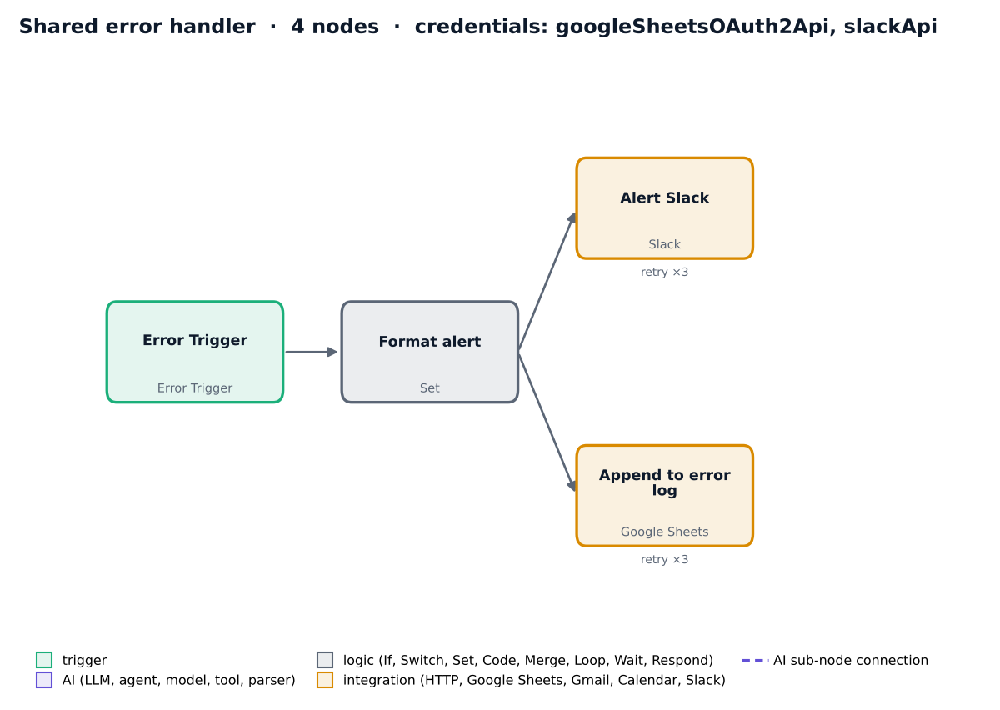

# Shared error handler

> Generated by `n8nkit docs` from [`workflows/00-error-handler.json`](../../workflows/00-error-handler.json). Edit the workflow, then run `make docs`.

The other templates set `settings.errorWorkflow` to this workflow's ID. When one of their executions fails after its node retries, n8n starts this workflow with the error details.

It posts an alert to Slack and appends a row to an error-log sheet.

**Needs:** Slack and Google Sheets credentials, `ERROR_LOG_SHEET_ID` env var.

| | |
|---|---|
| Workflow ID | `ErrHandlerShared` |
| Nodes | 4 |
| Error workflow | `—` |
| Execution order | `v1` |

## Trigger

- **Error Trigger**: starts when a workflow whose `settings.errorWorkflow` is `ErrHandlerShared` fails.

Used as the error workflow by: [Lead intake and qualification](01-lead-intake-qualifier.md), [Support triage agent with human approval](02-support-triage-agent.md), [Meeting scheduler with calendar availability](03-meeting-scheduler.md), [Daily KPI digest](04-daily-kpi-digest.md).

## Nodes

| # | Node | Type | Kind | Credential | Resilience |
|---|---|---|---|---|---|
| 1 | Error Trigger | `errorTrigger` v1 | trigger |  |  |
| 2 | Format alert | `set` v3.4 | logic |  |  |
| 3 | Alert Slack | `slack` v2.2 | integration | `Slack account` | retry 3× / 2000 ms |
| 4 | Append to error log | `googleSheets` v4.5 | integration | `Google Sheets account` | retry 3× / 2000 ms |

## Credentials to create

Create these in n8n (**Credentials → Add credential**) with the same names, or pick your own in each node after import.

| Credential type | Name used in the template | Used by | Notes |
|---|---|---|---|
| `googleSheetsOAuth2Api` | Google Sheets account | Append to error log | Google OAuth2 client with the Sheets API enabled |
| `slackApi` | Slack account | Alert Slack | Slack bot token with `chat:write` (invite the bot to the channel) |

## Environment variables

- `ERROR_LOG_SHEET_ID`: Google Sheet ID with an `Errors` tab

## What it writes or sends

- **Alert Slack**: Slack message to `#automation-alerts`
- **Append to error log**: Google Sheets `append` on tab `Errors`

## Setup

1. Import the file: **Workflows → Import from File**, or `n8n import:workflow --input=workflows/00-error-handler.json`.
2. Create the credentials above and select them in each node that shows a warning.
3. Set the environment variables (see `.env.example`), or replace the `$env` expressions with values.
4. Keep this workflow's ID so the other templates can reference it.
5. Run it once with **Test workflow** and the test URL, then activate it.
