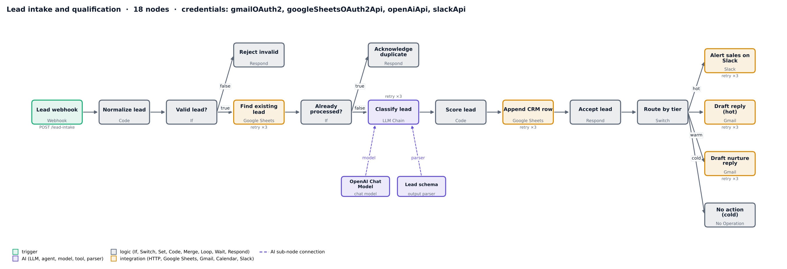

# Lead intake and qualification

> Generated by `n8nkit docs` from [`workflows/01-lead-intake-qualifier.json`](../../workflows/01-lead-intake-qualifier.json). Edit the workflow, then run `make docs`.



A website form posts to the webhook. The lead is normalised and de-duplicated by an idempotency key, classified by an LLM into a fixed schema, scored by plain rules and routed by tier.

- **hot**: Slack alert + Gmail reply draft
- **warm**: nurture reply draft
- **cold**: CRM row only

Replies are saved as drafts for a person to send. Every lead lands in the CRM sheet first.

| | |
|---|---|
| Workflow ID | `LeadIntakeQualif` |
| Nodes | 18 |
| Error workflow | `ErrHandlerShared` |
| Execution order | `v1` |

## Trigger

- **Lead webhook**: `POST /webhook/lead-intake` (answers from a Respond to Webhook node). Test URL while editing: `/webhook-test/lead-intake`.

## Nodes

| # | Node | Type | Kind | Credential | Resilience |
|---|---|---|---|---|---|
| 1 | Lead webhook | `webhook` v2 | trigger |  |  |
| 2 | Normalize lead | `code` v2 | logic |  |  |
| 3 | Valid lead? | `if` v2 | logic |  |  |
| 4 | Reject invalid | `respondToWebhook` v1.1 | logic |  |  |
| 5 | Find existing lead | `googleSheets` v4.5 | integration | `Google Sheets account` | retry 3× / 2000 ms, always output data |
| 6 | Already processed? | `if` v2 | logic |  |  |
| 7 | Acknowledge duplicate | `respondToWebhook` v1.1 | logic |  |  |
| 8 | Classify lead | `chainLlm` v1.4 | ai |  | retry 3× / 2000 ms |
| 9 | OpenAI Chat Model | `lmChatOpenAi` v1 | ai | `OpenAI account` |  |
| 10 | Lead schema | `outputParserStructured` v1.2 | ai |  |  |
| 11 | Score lead | `code` v2 | logic |  |  |
| 12 | Append CRM row | `googleSheets` v4.5 | integration | `Google Sheets account` | retry 3× / 2000 ms |
| 13 | Accept lead | `respondToWebhook` v1.1 | logic |  |  |
| 14 | Route by tier | `switch` v3 | logic |  |  |
| 15 | Alert sales on Slack | `slack` v2.2 | integration | `Slack account` | retry 3× / 2000 ms |
| 16 | Draft reply (hot) | `gmail` v2.1 | integration | `Gmail account` | retry 3× / 2000 ms |
| 17 | Draft nurture reply | `gmail` v2.1 | integration | `Gmail account` | retry 3× / 2000 ms |
| 18 | No action (cold) | `noOp` v1 | logic |  |  |

## Credentials to create

Create these in n8n (**Credentials → Add credential**) with the same names, or pick your own in each node after import.

| Credential type | Name used in the template | Used by | Notes |
|---|---|---|---|
| `gmailOAuth2` | Gmail account | Draft reply (hot), Draft nurture reply | Google OAuth2 client with the Gmail API enabled |
| `googleSheetsOAuth2Api` | Google Sheets account | Find existing lead, Append CRM row | Google OAuth2 client with the Sheets API enabled |
| `openAiApi` | OpenAI account | OpenAI Chat Model | OpenAI API key (platform.openai.com → API keys) |
| `slackApi` | Slack account | Alert sales on Slack | Slack bot token with `chat:write` (invite the bot to the channel) |

## Environment variables

- `CRM_SHEET_ID`: Google Sheet ID with a `Leads` tab

## What it writes or sends

- **Reject invalid**: HTTP 400 response to the caller
- **Find existing lead**: Google Sheets `read` on tab `Leads`
- **Acknowledge duplicate**: HTTP 200 response to the caller
- **Append CRM row**: Google Sheets `append` on tab `Leads`
- **Accept lead**: HTTP 202 response to the caller
- **Alert sales on Slack**: Slack message to `#sales-hot-leads`
- **Draft reply (hot)**: Gmail draft (not sent)
- **Draft nurture reply**: Gmail draft (not sent)

## AI nodes

- **Classify lead** (Basic LLM Chain): languageModel: OpenAI Chat Model; outputParser: Lead schema
  - output schema `lead_classification`: `intent`, `budget_band`, `urgency`, `summary`

## Try it

```bash
curl -s -X POST http://localhost:5678/webhook/lead-intake \
  -H 'content-type: application/json' \
  -d '{"name": "Nina Larsen", "email": "nina.larsen0@tidewaterenergy.example", "company": "Tidewater Energy", "company_size": 3, "budget_usd": 4000, "source": "website", "message": "Exploring options for an internal reporting dashboard; could you share case studies?", "submitted_at": "2026-11-16T08:00:00Z"}'
```

Simulated run of that input (`n8nkit simulate`, fake services, SYNTHETIC data):

```
execution 1001 · Lead intake and qualification · success
  1  Lead webhook             Webhook                in 1   out 1           
  2  Normalize lead           Code                   in 1   out 1           
  3  Valid lead?              If                     in 1   out 1/0         
  4  Find existing lead       Google Sheets          in 1   out 1           read Leads
  5  Already processed?       If                     in 1   out 0/1         
  6  Classify lead            Basic LLM Chain        in 1   out 1           lead_classification
  7  Score lead               Code                   in 1   out 1           
  8  Append CRM row           Google Sheets          in 1   out 1           append Leads
  9  Accept lead              Respond to Webhook     in 1   out 1           responded 202
 10  Route by tier            Switch                 in 1   out 0/0/1       
 11  No action (cold)         No Operation           in 1   out 1           
     response 202: {"status": "accepted", "lead_id": "lead_b5049400", "tier": "cold"}
```

## Setup

1. Import the file: **Workflows → Import from File**, or `n8n import:workflow --input=workflows/01-lead-intake-qualifier.json`.
2. Create the credentials above and select them in each node that shows a warning.
3. Set the environment variables (see `.env.example`), or replace the `$env` expressions with values.
4. Import `00-error-handler.json` too: the error workflow is linked by ID.
5. Run it once with **Test workflow** and the test URL, then activate it.
