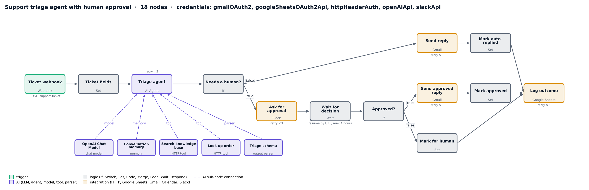

# Support triage agent with human approval

> Generated by `n8nkit docs` from [`workflows/02-support-triage-agent.json`](../../workflows/02-support-triage-agent.json). Edit the workflow, then run `make docs`.



A help-desk form posts each ticket to the webhook (answered with 202 at once). A tools agent searches the knowledge base, looks up the order when one is mentioned, and returns a structured triage with a draft reply.

Confident, routine answers are emailed. Anything flagged, or below 0.7 confidence, goes to Slack for approval and the workflow **waits** for the reviewer's click (4 h limit). Every outcome is logged to a sheet.

| | |
|---|---|
| Workflow ID | `SupportTriageAgt` |
| Nodes | 18 |
| Error workflow | `ErrHandlerShared` |
| Execution order | `v1` |

## Trigger

- **Ticket webhook**: `POST /webhook/support-ticket` (answers 202 immediately, then runs). Test URL while editing: `/webhook-test/support-ticket`.

## Nodes

| # | Node | Type | Kind | Credential | Resilience |
|---|---|---|---|---|---|
| 1 | Ticket webhook | `webhook` v2 | trigger |  |  |
| 2 | Ticket fields | `set` v3.4 | logic |  |  |
| 3 | Triage agent | `agent` v1.7 | ai |  | retry 3× / 2000 ms |
| 4 | OpenAI Chat Model | `lmChatOpenAi` v1 | ai | `OpenAI account` |  |
| 5 | Conversation memory | `memoryBufferWindow` v1.2 | ai |  |  |
| 6 | Search knowledge base | `toolHttpRequest` v1.1 | ai | `Helpdesk API key` |  |
| 7 | Look up order | `toolHttpRequest` v1.1 | ai | `Helpdesk API key` |  |
| 8 | Triage schema | `outputParserStructured` v1.2 | ai |  |  |
| 9 | Needs a human? | `if` v2 | logic |  |  |
| 10 | Send reply | `gmail` v2.1 | integration | `Gmail account` | retry 3× / 2000 ms |
| 11 | Ask for approval | `slack` v2.2 | integration | `Slack account` | retry 3× / 2000 ms |
| 12 | Wait for decision | `wait` v1.1 | logic |  |  |
| 13 | Approved? | `if` v2 | logic |  |  |
| 14 | Send approved reply | `gmail` v2.1 | integration | `Gmail account` | retry 3× / 2000 ms |
| 15 | Mark auto-replied | `set` v3.4 | logic |  |  |
| 16 | Mark approved | `set` v3.4 | logic |  |  |
| 17 | Mark for human | `set` v3.4 | logic |  |  |
| 18 | Log outcome | `googleSheets` v4.5 | integration | `Google Sheets account` | retry 3× / 2000 ms |

## Credentials to create

Create these in n8n (**Credentials → Add credential**) with the same names, or pick your own in each node after import.

| Credential type | Name used in the template | Used by | Notes |
|---|---|---|---|
| `gmailOAuth2` | Gmail account | Send reply, Send approved reply | Google OAuth2 client with the Gmail API enabled |
| `googleSheetsOAuth2Api` | Google Sheets account | Log outcome | Google OAuth2 client with the Sheets API enabled |
| `httpHeaderAuth` | Helpdesk API key | Search knowledge base, Look up order | Header Auth: name `X-API-Key`, value = your API key (any value works for the mock API) |
| `openAiApi` | OpenAI account | OpenAI Chat Model | OpenAI API key (platform.openai.com → API keys) |
| `slackApi` | Slack account | Ask for approval | Slack bot token with `chat:write` (invite the bot to the channel) |

## Environment variables

- `HELPDESK_API_URL`: Base URL of the help-desk API (`http://mock-services:8080` in docker compose)
- `SUPPORT_LOG_SHEET_ID`: Google Sheet ID with a `Triage log` tab

## HTTP endpoints called

- **Search knowledge base**: `={{ $env.HELPDESK_API_URL }}/kb/search`
- **Look up order**: `={{ $env.HELPDESK_API_URL }}/orders/{order_id}`

## What it writes or sends

- **Send reply**: Gmail send
- **Ask for approval**: Slack message to `#support-escalations`
- **Send approved reply**: Gmail send
- **Log outcome**: Google Sheets `append` on tab `Triage log`

## AI nodes

- **Triage agent** (AI Agent): languageModel: OpenAI Chat Model; tool: Search knowledge base, Look up order; memory: Conversation memory; outputParser: Triage schema
  - output schema `ticket_triage`: `category`, `priority`, `confidence`, `needs_human`, `reason`, `draft_reply`, `cited_articles`, `order_id`

## Try it

```bash
curl -s -X POST http://localhost:5678/webhook/support-ticket \
  -H 'content-type: application/json' \
  -d '{"ticket_id": "T-2001", "email": "customer01@shop.example", "subject": "Where is my parcel", "message": "Order ORD-10196 has not arrived and tracking shows delayed."}'
```

Simulated run of that input (`n8nkit simulate`, fake services, SYNTHETIC data):

```
execution 1002 · Support triage agent with human approval · success
  1  Ticket webhook           Webhook                in 1   out 1           
  2  Ticket fields            Edit Fields (Set)      in 1   out 1           
  3  Triage agent             AI Agent               in 1   out 1           ticket_triage; tools: Search knowledge base, Look up order; memory: 0 earlier
  4  Needs a human?           If                     in 1   out 0/1         
  5  Send reply               Gmail                  in 1   out 1           sent to customer01@shop.example
  6  Mark auto-replied        Edit Fields (Set)      in 1   out 1           
  7  Log outcome              Google Sheets          in 1   out 1           append Triage log
     response 202: {"message": "Workflow was started"}
```

## Setup

1. Import the file: **Workflows → Import from File**, or `n8n import:workflow --input=workflows/02-support-triage-agent.json`.
2. Create the credentials above and select them in each node that shows a warning.
3. Set the environment variables (see `.env.example`), or replace the `$env` expressions with values.
4. Import `00-error-handler.json` too: the error workflow is linked by ID.
5. Run it once with **Test workflow** and the test URL, then activate it.
