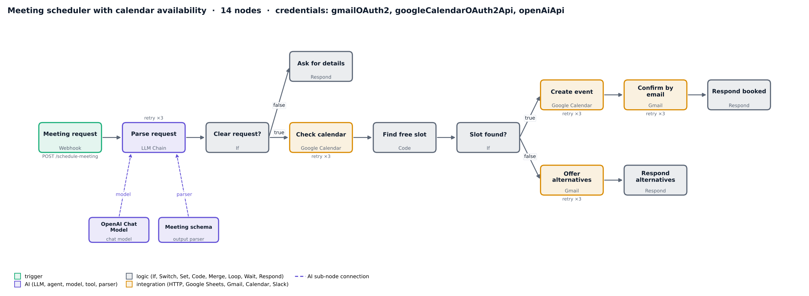

# Meeting scheduler with calendar availability

> Generated by `n8nkit docs` from [`workflows/03-meeting-scheduler.json`](../../workflows/03-meeting-scheduler.json). Edit the workflow, then run `make docs`.



Takes a plain-language request ("45 minutes on Thursday afternoon to review the proposal"). An LLM turns it into a duration and a time window with a fixed schema; Google Calendar returns the busy slots; a Code node finds the first free slot in working hours.

If one is free, the event is created and confirmed by email (201). Otherwise up to three alternatives are emailed (200). Vague requests get a 422 asking for a day.

| | |
|---|---|
| Workflow ID | `MeetingScheduler` |
| Nodes | 14 |
| Error workflow | `ErrHandlerShared` |
| Execution order | `v1` |

## Trigger

- **Meeting request**: `POST /webhook/schedule-meeting` (answers from a Respond to Webhook node). Test URL while editing: `/webhook-test/schedule-meeting`.

## Nodes

| # | Node | Type | Kind | Credential | Resilience |
|---|---|---|---|---|---|
| 1 | Meeting request | `webhook` v2 | trigger |  |  |
| 2 | Parse request | `chainLlm` v1.4 | ai |  | retry 3× / 2000 ms |
| 3 | OpenAI Chat Model | `lmChatOpenAi` v1 | ai | `OpenAI account` |  |
| 4 | Meeting schema | `outputParserStructured` v1.2 | ai |  |  |
| 5 | Clear request? | `if` v2 | logic |  |  |
| 6 | Ask for details | `respondToWebhook` v1.1 | logic |  |  |
| 7 | Check calendar | `googleCalendar` v1.2 | integration | `Google Calendar account` | retry 3× / 2000 ms, always output data |
| 8 | Find free slot | `code` v2 | logic |  |  |
| 9 | Slot found? | `if` v2 | logic |  |  |
| 10 | Create event | `googleCalendar` v1.2 | integration | `Google Calendar account` | retry 3× / 2000 ms |
| 11 | Confirm by email | `gmail` v2.1 | integration | `Gmail account` | retry 3× / 2000 ms |
| 12 | Respond booked | `respondToWebhook` v1.1 | logic |  |  |
| 13 | Offer alternatives | `gmail` v2.1 | integration | `Gmail account` | retry 3× / 2000 ms |
| 14 | Respond alternatives | `respondToWebhook` v1.1 | logic |  |  |

## Credentials to create

Create these in n8n (**Credentials → Add credential**) with the same names, or pick your own in each node after import.

| Credential type | Name used in the template | Used by | Notes |
|---|---|---|---|
| `gmailOAuth2` | Gmail account | Confirm by email, Offer alternatives | Google OAuth2 client with the Gmail API enabled |
| `googleCalendarOAuth2Api` | Google Calendar account | Check calendar, Create event | Google OAuth2 client with the Calendar API enabled |
| `openAiApi` | OpenAI account | OpenAI Chat Model | OpenAI API key (platform.openai.com → API keys) |

## Environment variables

- `SCHEDULING_CALENDAR_ID`: Google Calendar ID to check and book (`primary` works)

## What it writes or sends

- **Ask for details**: HTTP 422 response to the caller
- **Check calendar**: Google Calendar availability check
- **Create event**: Google Calendar event create
- **Confirm by email**: Gmail send
- **Respond booked**: HTTP 201 response to the caller
- **Offer alternatives**: Gmail send
- **Respond alternatives**: HTTP 200 response to the caller

## AI nodes

- **Parse request** (Basic LLM Chain): languageModel: OpenAI Chat Model; outputParser: Meeting schema
  - output schema `meeting_request`: `duration_minutes`, `window_start`, `window_end`, `topic`, `needs_clarification`

## Try it

```bash
curl -s -X POST http://localhost:5678/webhook/schedule-meeting \
  -H 'content-type: application/json' \
  -d '{"requester_email": "requester02@client.example", "request_text": "An hour on Thursday afternoon to review the proposal"}'
```

Simulated run of that input (`n8nkit simulate`, fake services, SYNTHETIC data):

```
execution 1003 · Meeting scheduler with calendar availability · success
  1  Meeting request          Webhook                in 1   out 1           
  2  Parse request            Basic LLM Chain        in 1   out 1           meeting_request
  3  Clear request?           If                     in 1   out 1/0         
  4  Check calendar           Google Calendar        in 1   out 1           0 busy slots
  5  Find free slot           Code                   in 1   out 1           
  6  Slot found?              If                     in 1   out 1/0         
  7  Create event             Google Calendar        in 1   out 1           event evt-0001
  8  Confirm by email         Gmail                  in 1   out 1           sent to requester02@client.example
  9  Respond booked           Respond to Webhook     in 1   out 1           responded 201
     response 201: {"status": "booked", "start": "2026-11-19T13:00:00.000Z", "end": "2026-11-19T14:00:00.000Z"}
```

## Setup

1. Import the file: **Workflows → Import from File**, or `n8n import:workflow --input=workflows/03-meeting-scheduler.json`.
2. Create the credentials above and select them in each node that shows a warning.
3. Set the environment variables (see `.env.example`), or replace the `$env` expressions with values.
4. Import `00-error-handler.json` too: the error workflow is linked by ID.
5. Run it once with **Test workflow** and the test URL, then activate it.
