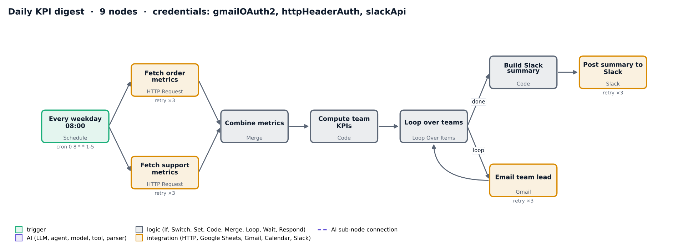

# Daily KPI digest

> Generated by `n8nkit docs` from [`workflows/04-daily-kpi-digest.json`](../../workflows/04-daily-kpi-digest.json). Edit the workflow, then run `make docs`.



Every weekday at 08:00 it pulls yesterday's order and support metrics from two HTTP APIs, merges them, computes per-team KPIs and anomaly flags in a Code node, emails each team lead (Loop Over Items, one team at a time) and posts one summary to Slack.

| | |
|---|---|
| Workflow ID | `DailyKpiDigest01` |
| Nodes | 9 |
| Error workflow | `ErrHandlerShared` |
| Execution order | `v1` |

## Trigger

- **Every weekday 08:00**: schedule, cron `0 8 * * 1-5` in the instance timezone (`GENERIC_TIMEZONE`).

## Nodes

| # | Node | Type | Kind | Credential | Resilience |
|---|---|---|---|---|---|
| 1 | Every weekday 08:00 | `scheduleTrigger` v1.2 | trigger |  |  |
| 2 | Fetch order metrics | `httpRequest` v4.2 | integration | `Metrics API key` | retry 3× / 2000 ms |
| 3 | Fetch support metrics | `httpRequest` v4.2 | integration | `Metrics API key` | retry 3× / 2000 ms |
| 4 | Combine metrics | `merge` v3 | logic |  |  |
| 5 | Compute team KPIs | `code` v2 | logic |  |  |
| 6 | Loop over teams | `splitInBatches` v3 | logic |  |  |
| 7 | Email team lead | `gmail` v2.1 | integration | `Gmail account` | retry 3× / 2000 ms |
| 8 | Build Slack summary | `code` v2 | logic |  |  |
| 9 | Post summary to Slack | `slack` v2.2 | integration | `Slack account` | retry 3× / 2000 ms |

## Credentials to create

Create these in n8n (**Credentials → Add credential**) with the same names, or pick your own in each node after import.

| Credential type | Name used in the template | Used by | Notes |
|---|---|---|---|
| `gmailOAuth2` | Gmail account | Email team lead | Google OAuth2 client with the Gmail API enabled |
| `httpHeaderAuth` | Metrics API key | Fetch order metrics, Fetch support metrics | Header Auth: name `X-API-Key`, value = your API key (any value works for the mock API) |
| `slackApi` | Slack account | Post summary to Slack | Slack bot token with `chat:write` (invite the bot to the channel) |

## Environment variables

- `METRICS_API_URL`: Base URL of the metrics API (`http://mock-services:8080` in docker compose)

## HTTP endpoints called

- **Fetch order metrics**: `={{ $env.METRICS_API_URL }}/metrics/orders`
- **Fetch support metrics**: `={{ $env.METRICS_API_URL }}/metrics/support`

## What it writes or sends

- **Email team lead**: Gmail send
- **Post summary to Slack**: Slack message to `#kpi-digest`

## Try it

Simulated run of that input (`n8nkit simulate`, fake services, SYNTHETIC data):

```
execution 1004 · Daily KPI digest · success
  1  Every weekday 08:00      Schedule Trigger       in 1   out 1           
  2  Fetch order metrics      HTTP Request           in 1   out 1           
  3  Fetch support metrics    HTTP Request           in 1   out 1           
  4  Combine metrics          Merge                  in 2   out 1           
  5  Compute team KPIs        Code                   in 1   out 4           
  6  Loop over teams          Loop Over Items        in 4   out 0/1         
  7  Email team lead          Gmail                  in 1   out 1           sent to north.lead@example.com
  8  Loop over teams          Loop Over Items        in 1   out 0/1         
  9  Email team lead          Gmail                  in 1   out 1           sent to south.lead@example.com
 10  Loop over teams          Loop Over Items        in 1   out 0/1         
 11  Email team lead          Gmail                  in 1   out 1           sent to east.lead@example.com
 12  Loop over teams          Loop Over Items        in 1   out 0/1         
 13  Email team lead          Gmail                  in 1   out 1           sent to west.lead@example.com
 14  Loop over teams          Loop Over Items        in 1   out 4/0         done after 4 items
 15  Build Slack summary      Code                   in 4   out 1           
 16  Post summary to Slack    Slack                  in 1   out 1           posted to #kpi-digest
```

## Setup

1. Import the file: **Workflows → Import from File**, or `n8n import:workflow --input=workflows/04-daily-kpi-digest.json`.
2. Create the credentials above and select them in each node that shows a warning.
3. Set the environment variables (see `.env.example`), or replace the `$env` expressions with values.
4. Import `00-error-handler.json` too: the error workflow is linked by ID.
5. Run it once with **Test workflow** and the test URL, then activate it.
